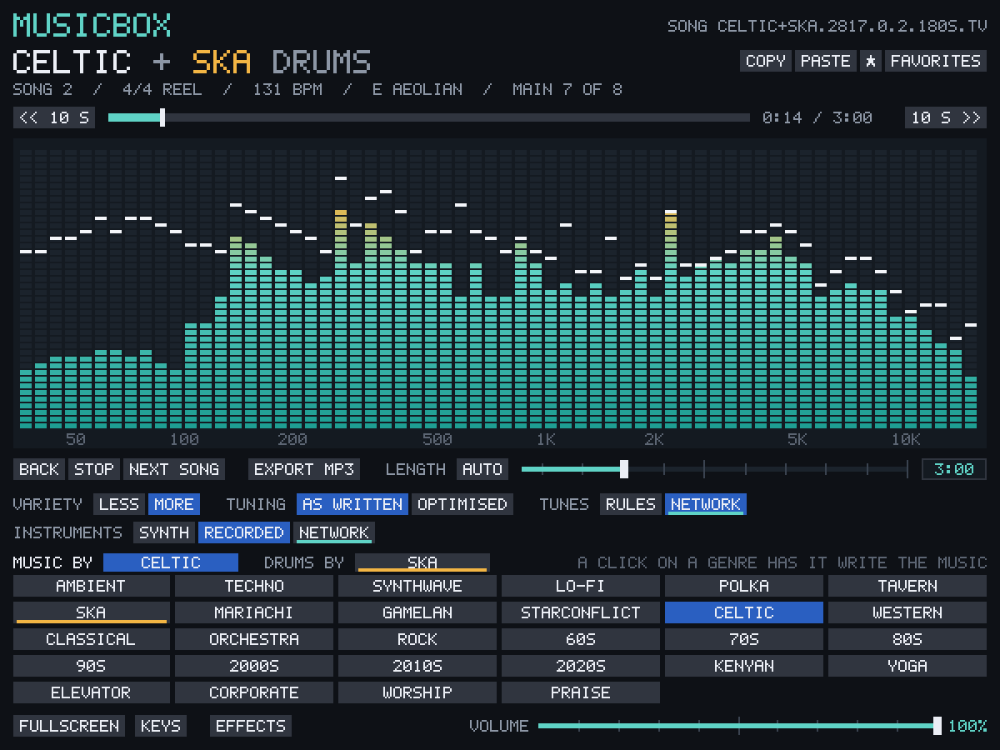
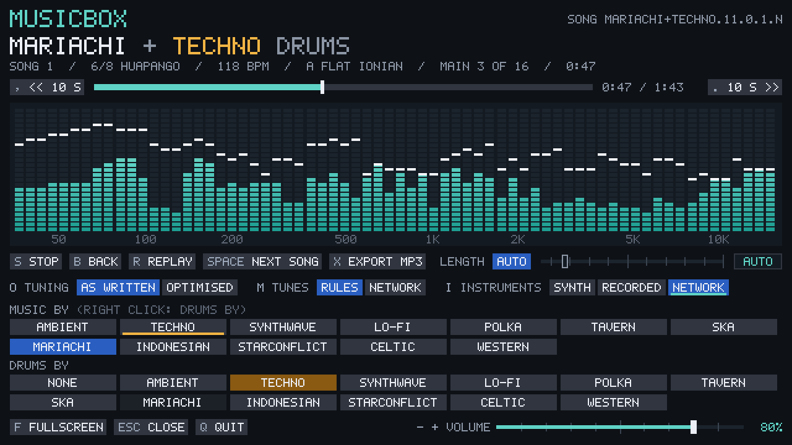

# musicbox

Made by Claude Opus 5.5, instigated by [Brandon Hoult](https://hoult.co).

Music made up as it plays, without end, in 28 genres and any pair of them. It plays from the command line, can open a window with a live equalizer and a genre selector, and runs in a browser.

**[Play it in your browser](https://bhoult.github.io/musicbox/)**: no install; it plays recordings of real instruments, fetched as each genre needs them, or a synthesiser with nothing to fetch.

[](https://bhoult.github.io/musicbox/)

As it comes, no AI model makes any of the sound or the music, and no song is sampled. The music comes from a composer that is ordinary code: for each genre, rules for its scales, chords, rhythms, song forms and who plays what, and a random number generator choosing among them. It is generated at random and without end by software that an AI wrote. A genre and a seed always give the same music.

Three settings, each off until chosen, bring in what was learned from real music ([below](#how-it-is-made)): six genres' mixes as an optimiser tuned them against real recordings, celtic tunes written by a small network that learned O'Neill's *Music of Ireland*, and 18 instruments played by small networks that learned their recordings.

It was extracted from fleece, a fractal flame animator, whose videos in [flock](https://experiments.galedra.org/flock/) it scored. The composer, synthesiser and sampler are fleece's code, since tuned against recordings of the real genres ([below](#checked-against-real-music)): polka, synthwave, tavern, lo-fi, starconflict, gamelan and mariachi now sound different from fleece's, as do mixes with any of them in either part; the other genres, and mixes of them alone, still write fleece's bytes for a given genre and seed, with the three settings as they come.

```
cargo build --release
target/release/musicbox                    # a random genre, from a random seed
target/release/musicbox celtic             # a genre by name (or number, 0-11)
target/release/musicbox polka+techno       # polka's music with techno's drums
target/release/musicbox western --gui      # with the window open
target/release/musicbox lo-fi --eq         # with an equalizer in the terminal
target/release/musicbox ska --length 3:00  # each song three minutes long
target/release/musicbox techno --volume 60 # quieter (0 to 100)
target/release/musicbox --export celtic reel.mp3 --seed 7 --song 2   # one song, to an MP3
target/release/musicbox ska.2817.1.2       # a song by its id, and on from it
target/release/musicbox --export ska.2817.1.2 ska.mp3                # a song by its id, to an MP3
target/release/musicbox celtic --net-tunes --voices network    # tunes and instruments by networks
```

## The command line

The terminal shows what is playing and the keys, redrawn in place:

```
♪ musicbox  celtic with ska drums                         song celtic+ska.2817.0.2.180s
  song 2 · 4/4 reel · 131 bpm · C ionian · main, bar 3 of 8 · 0:07 / 3:00
  ‹ polka tavern ska mariachi gamelan starconflict celtic western classical orchestra rock 60s 70s 80s
  ←/→ genre  ↑/↓ drums  space next song  b back  , . 10 s back and on
  s stop  r replay  x export mp3  d type a song's id  q quit
  [ ] length 3:00  - + volume 100%  t type a length  e equalizer  g window
  o tuning as written  m tunes rules  i instruments recorded
```

The top line ends with the song's id ([below](#song-ids)). The third line is the genre selector: the genre writing the music is lit, and the drummer is underlined. A terminal too narrow for all 28 shows a window of them about the genre playing, ‹ marking that some come before. The song line gives the piece's number, meter and form, tempo, key and mode, its section and bar, how long it has played, and the length asked of it. The last line is how the music is made ([below](#how-it-is-made)), with a note where a choice does nothing for the genre playing (celtic alone has network tunes, for one).

| key | |
| --- | --- |
| Left / Right (also P / N) | previous / next genre |
| Up / Down (also J) | the drummer: each genre in turn (the one writing the music plays its own drums) |
| Space, Enter (also Y) | next song: a new piece of the same music (after going back, the song that came next) |
| B | back: the song playing from its start; in its first 3 s, the song before it |
| , / . (also < / >) | 10 s back or on in the song playing |
| S | stop, and start again where it stopped |
| R | replay: the song playing, from its start again |
| [ / ] | each song 15 s shorter or longer (from auto: about the song's own length; below 0:30, auto again) |
| - / + (also =) | the volume down or up, 5% a step ([below](#volume)) |
| T | type a length: 3:30, 3.5m, 210s, or auto; Enter sets it, Esc cancels |
| D | type a song's id: Enter plays it, Esc cancels |
| X | export the song playing, from its start to its end, to an MP3 in ~/Music/musicbox |
| O | tuning: as written, or optimised |
| M | tunes: by the rules, or by the network |
| I | instruments: the synthesiser, the recordings, or the networks |
| E | the equalizer in the terminal, on or off (`--eq` starts with it on) |
| G | open or close the window (`--gui` opens it at the start) |
| ? (also F1) | every key, in one list, in the window and on the page |
| Q, Esc, Ctrl-C | quit |

A change waits for the next bar line, or the next beat when bars are long, and then crossfades. Back, forward to a song, a song's id and a point in the song go at once. Run outside a terminal, musicbox prints one line for each new piece instead.

## The window



`--gui` or G opens it. It has six parts:

- **What is playing:** the genres and the song's id (click it to type one to play), then the terminal's song line, less the time, which the bar below shows. A genre or drummer just chosen shows at the right until the next bar brings it in.
- **Where in the song:** a bar to click, or drag and let go, to go to a point in the song, between buttons 10 s back and on, and the time played of the song's length.
- **The equalizer:** what the speakers are playing, in LED bars from 35 Hz to 16 kHz with peak markers. Each bar is the loudest part of its band in an 85 ms window, tilted up 3 dB an octave so the highs show.
- **The transport and the length:** BACK, STOP / START, NEXT SONG and EXPORT MP3 (R replays the song, as BACK does after its first seconds), then the songs' length: AUTO (each song as long as it was written), a slider from 0:30 to 10:00 (drag it, click it, or turn the mouse wheel over it), and a field to type a length into (click it, or press T).
- **How it is made:** TUNING (AS WRITTEN, OPTIMISED), TUNES (RULES, NETWORK) and INSTRUMENTS (SYNTH, RECORDED, NETWORK), as O, M and I have them. A choice that does something for the genre playing is underlined in the accent colour.
- **The genre selector:** all 28 genres in one grid: click one to write the music, or right-click it to put it on drums (it is underlined there). DRUMS BY, at the right of the grid's heading, steps the drummer with its arrows, as Up and Down do; it says ITS OWN when the genre writing the music plays its own drums, and a click on the drummer's name goes back to them. Below are buttons for FULLSCREEN (F or F11), CLOSE (Esc), QUIT (Q) and KEYS (? or F1), and the VOLUME: a slider from 0 to 100% (drag it, click it, or turn the mouse wheel over it).

The keys work in the window too. The buttons leave them out: rest the mouse on anything and it says what it does and its keys, and ? lists them all. Closing the window leaves the music playing in the terminal. Without a terminal (a launcher, say), closing it quits.

The picture is drawn on the CPU and scaled up by a whole number, so its pixel font stays sharp at any size. It is never smaller than 480 by 300, which everything fits; a smaller window (or a narrow one) wraps the settings onto two lines.

## Song length

A song is as long as the composer writes it (about two minutes, from one to five) until a length is asked for: `--length 3:00`, the slider, `[` and `]`, or a length typed. Then each song steers for it as it plays: at a section's start, or every second bar of a main section, it turns to its outro early when going on would run long, or back to a main section (the earliest whose sections up to the outro fit) when it would end short. So songs keep their intro, form and ending, and land within a few seconds of the mark (asked 1:30, 3:00 or 6:40, every genre's songs came within 6 s). The shortest a song can be is its intro, four bars of its first main section and its outro (30 s to a minute). A new length applies to the song playing at its next turn.

## Start, stop and replay

Stop fades out in 30 ms and holds the music where it is; start goes on from there. A genre, drummer or next song chosen while stopped begins at once, from its start, when it plays again. Replay plays the song playing again from its start, crossfading at the next bar line as a genre change does: the engine is kept as it was when each song began, so the replay is the same music, note for note.

## Volume

`-` and `+` (or `=`) turn it down and up, 5% a step, from 0 to 100%; the window and the page have a slider for it, and `--volume 60` starts at 60%. The scale is cubic, as PulseAudio's volumes are, so each step sounds about as much louder: 50% is an eighth of the full level (−18 dB). A change eases in over the next buffer (85 ms), with no click. It is how loud it plays and nothing more: the equalizer shows the music at its full level, and an export is at full level whatever the volume. The page remembers its volume in the browser; the desktop app starts at 100% (or `--volume`) each time.

## Song ids

Every song has an id, shown at the top of the terminal, the window and the page: `ska.2817.1.2` is ska from seed 2817, the run of songs begun by its first skip or genre change (0 is the first run), and that run's second song. A length asked is added in seconds (`.180s`), and the settings that are not as they come in letters: `o` optimised, `t` network tunes, `s` the synthesiser's instruments, `n` the network's (`celtic.5.0.2.180s.tn`). The id plays the song again, later or elsewhere: `musicbox ska.2817.1.2`, D and typing it, the page's field, or the page's address (`bhoult.github.io/musicbox/#ska.2817.1.2`, which follows the song playing). It sets the genre, the length and the settings it gives, and the music goes on from that song as it would have.

**How exactly.** The networks have fixed weights and their own seeded dice, so nothing in the music is left to chance: a song from its id has the same notes, form, instruments and settings, on the desktop and in the browser alike. The first song of a run comes back to the byte. A later one has the same notes, with small differences in the sound (which recording of a drum plays, the noise) when gone to from its id; an export from its id (`--export ID`, the page's SAVE) plays the songs before it in its run to get there, and is the same to the byte as the song as it first played, in the same build. An id ending in `~` was made after the length changed earlier in its run, or while it played: the songs before it were steered to another length, so its notes may come out otherwise.

**Back and forward.** The songs played are kept in order, the last twelve as each began. B plays the song playing from its start, or, in its first 3 seconds, the one before it; after going back, the next song is the one that came next (as it played, with its length and settings), until another genre or song is chosen. These come back as they played, at once.

**A point in a song.** The window's and the page's bar, and , and . (10 s back and on), go to a point in the song playing: the bars before it are composed again from the song's start, not played, so the music goes on at once from the start of the bar then, with a short crossfade.

## Saving a song

X (or the window's EXPORT MP3) saves the song playing, on its own, from its start to its end and a few seconds' ring-out, to `~/Music/musicbox/ID.mp3`, named by its id. It is rendered again from the song's start, faster than it plays (a three-minute song in two or three seconds), so the music goes on meanwhile. The MP3 is VBR at about 190 kbps, made by LAME's library (libmp3lame0 on Debian and Ubuntu), which musicbox loads only when it exports; its ID3 tag has the genre, the song's meter, tempo and key, its id, and the command that makes it again:

```
target/release/musicbox --export ID OUT.mp3
target/release/musicbox --export GENRE OUT.mp3 --seed SEED --song K [--length L] [--tuned] [--net-tunes] [--voices V]
```

`--export` renders a song by its id, or the Kth song (1 by default) of a genre and seed, alone; a name ending in .wav writes a WAV instead (no LAME needed).

## In the browser

[bhoult.github.io/musicbox](https://bhoult.github.io/musicbox/) is the same composer and synthesiser compiled to WebAssembly (1.5 MB): the genres and mixes, the equalizer, the genre selector, the transport with back and forward, the bar to go to a point in the song, the length, the volume, the three settings, song ids and the keys as the window has them. The genres are one grid, as in the window, with the drummer chosen from a list beside its heading (or by right-clicking a genre). The song's id is in a field beside its name: paste or type one there and press Enter to play it, or COPY LINK for a link that plays it. Whatever the mouse rests on says what it does and its keys, and ? lists them all. SAVE MP3 (X) saves an MP3 of the song playing, named by its id, with the desktop's tag; WAV (shift-X) saves a WAV. The page encodes it with LAME too, compiled to WebAssembly (`docs/app/mp3/`, 133 kB, fetched with the first export), at a constant 192 kb/s: that build writes no info frame, which a VBR file needs for players to tell its length. The engine runs in a Web Worker a few tenths of a second ahead of an AudioWorklet that plays it, so writing a bar or starting a song never stalls the sound.

It plays recorded instruments, as the desktop does: before the first song it fetches the recordings its genre plays, and on a change of genre or drummer those of the new one, before it comes in. SYNTH (or I) plays the synthesiser instead, with nothing to fetch, and so does the page when the recordings will not load. They are the desktop's recordings made mono at 48 kHz and compressed to Opus at 48 kb/s: 4 to 26 MB a genre, and 59 MB for all 28, against the desktop's gigabyte. NETWORK instruments fetch their networks as well (4.2 MB), and network tunes fetch celtic's (0.8 MB). Each is fetched once, when it is first needed. The recordings are in this repository, in `docs/samples/`, with their sources and licences (`README.md`, `SOURCES.md`, `licenses/`).

```
rustup target add wasm32-unknown-unknown
cargo build --release --target wasm32-unknown-unknown --manifest-path web/Cargo.toml
cp web/target/wasm32-unknown-unknown/release/musicbox_web.wasm docs/app/musicbox.wasm
cp models/index.tsv models/*.mbn models/*.mbt docs/app/models/
tools/web-samples.sh docs/samples  # the recordings for the page (needs ffmpeg with libopus)
tools/stamp-page.sh                # after any change in docs/app or docs/samples
python3 -m http.server -d docs     # then http://localhost:8000
```

`tools/stamp-page.sh` writes a hash of the page's files, and one of the recordings, into the address `docs/index.html` loads `app/app.js` from, and the page asks for every file with them. GitHub Pages lets a browser keep a copy of each file for 10 minutes, so without the stamps a new `index.html` could run with the `app.js` from before, and its controls would not work.

`tools/web-samples.sh` runs `musicbox --web-pack`, which plays 60 songs of each genre and 8 of each mix, at their own length, to see which recordings each uses. It writes them out as one stream for each instrument (a recording that two instruments share is stored once). A mix fetches its two genres' recordings and whatever more it was heard to play. Anything a song plays that was never heard plays on the synthesiser in the browser, as a part with no recording does on the desktop. It then compresses each stream to Opus, and copies the samples' sources and licences in with them. `web/lib.rs` builds src/music.rs and what it uses unchanged, and exports plain functions over the module's memory (no crates, no bindings generator); `docs/app/` is the page's JavaScript.

## The genres

| genre | |
| --- | --- |
| ambient | slow pads and choirs, bells, celesta, kalimba and harp over a drone, with wind or rain drifting through |
| techno | a kick on every beat, claps, an acid bassline, a rumble under the kick and the sidechain pumping |
| synthwave | arpeggios and pads, a synth lead, and a drum machine with the kick on one and three |
| lo-fi | a boom-bap beat under electric piano and a lazy lead, with vinyl crackle and tape wow |
| polka | oom on the beat and pah off it, with tuba and accordion |
| tavern | medieval jigs, reels and dances on lute, fiddle, whistle, hurdy-gurdy and frame drum |
| ska | Jamaican first wave, faster and straighter 2-tone, or third-wave ska-punk with choruses of distorted power chords under four horns |
| mariachi | a son jalisciense, huapango, ranchera valseada or polkeada, or bolero ranchero: violins and trumpets trading the tune in thirds and sixths over vihuela, guitar, guitarrón and harp |
| gamelan | gamelan in tunings of its own, not the piano's: Javanese court gamelan or Balinese gong kebyar (INDONESIAN until 2026-11-01; old ids that say so still play) |
| starconflict | a space-opera film score in John Williams's manner, its themes the composer's own: a heroic march, a dark march or a battle |
| celtic | the Irish and Scottish session: sets of reels, jigs and hornpipes, a pipe set, or a slow air on the harp |
| western | a spaghetti-western score in Ennio Morricone's manner, its tunes the composer's own: the duel, the ride or the lament |
| classical | a piano sonata's allegro (an Alberti bass under a tune in periods), a string quartet's minuet, or a baroque trio sonata (harpsichord, a walking continuo, two violins in thirds) |
| orchestra | a Romantic symphony's movement (the violins' theme, the horns' counter-line, a brass chorale, harp and timpani), a Viennese waltz, or a strings' adagio |
| rock | riff-driven hard rock, an arena anthem with its tune on the lead guitar, or a 12/8 blues shuffle in twelve-bar choruses, with solos |
| 60s | Motown-style soul (the snare on every beat, a tambourine, a running bass, horns), surf (a tremolo guitar deep in the spring, floor toms), or beat music (a twelve-string's jangle, harmonica) |
| 70s | disco (four on the floor, octave bass, strings, the funk guitar's 16ths), funk (the one, ghosted snares, clavinet, horns), or soft rock |
| 80s | synth-pop (a LinnDrum, a gated snare, FM keys, a polysynth's chorus), the power ballad, or new wave |
| 90s | eurodance (the off-beat bass, piano stabs, builds), grunge (a quiet verse, a loud chorus), or the R&B slow jam |
| 2000s | pop-punk, the R&B of pizzicato stabs and 808s, or electro-pop |
| 2010s | big-room EDM (builds and drops), tropical house, trap-pop, or the folk stomp |
| 2020s | nu-disco, amapiano (the log drum, the shaker, jazz piano), or afrobeats |
| kenyan | benga (the bass running through the chord, interlocking guitars, the kayamba's shaker), Kenyan rumba, or the Luo nyatiti lyre with its ongeng'o ring and the orutu fiddle |
| yoga | a meditation (a tanpura, a bansuri's slow tune, singing bowls), a flow (hand drums like a tabla's, kalimba), or a kirtan (harmonium, tabla, manjira) |
| elevator | bossa nova, lounge swing (brushes, a walking bass, vibraphone), or smooth (Rhodes, alto sax) |
| corporate | uplifting (piano eighths, pizzicato, a glockenspiel's hook), tech (four on the floor, plucks), or acoustic (strummed guitar, claps, a whistled hook) |
| worship | the ballad that builds from piano and pad to the band (an electric guitar's dotted-eighth echoes), a 6/8 hymn, or the anthem |
| praise | gospel (the piano's pushed chords, organ, choir stabs, tambourine and claps), a 12/8 shuffle, or contemporary praise |

The names `indonesian`, `keltic`, `spaghetti-western`, `space-opera`, `orchestral`, `symphony`, `sixties` (and the other decades in words, or as `1960s`), `benga`, `meditation`, `muzak`, `easy listening`, `lounge` and `gospel` work too, and `60's` is `60s`.

The sixteen genres from classical on are each two to four styles, and one composer plays them (`src/music/styled.rs`): a style is a table in `src/music/styles.rs` of its meter, tempo, swing and modes, its chords, its form, its drums' lines, how its bass, chords, arpeggio, tune and second voice go, and its instruments. The tanpura, the singing bowl, the log drum and the 808 are the synthesiser's; every other instrument they play is a recording the first twelve use too.

The composer writes pieces of about two minutes (50 to 190 bpm). Each piece has its own key, mode, tempo, chord progressions, drum patterns, bassline, melody and a second voice answering it, laid out in sections with something changing every four bars. Within a piece the bass mutates at phrase ends, the melody comes back varied, and filters drift. The next piece usually moves to a neighbouring key. It never loops, though each genre keeps its style.

**Mixes.** Two genres joined with `+` (or chosen with the drummer keys) make a mix. The first writes the music: its form, meter, chords and tunes. The second drums it: its beat fitted to the first's meter, its kits and effects, and a tempo 60% of the way to its own. Each part gets an instrument from each genre. Any of the 756 pairs plays.

## Recorded instruments

Every genre plays recordings of real instruments once `tools/get-samples.sh` has fetched them. Without them, a small synthesiser plays everything: band-limited oscillators, resonant filters, FM bells and electric piano, and synthesised drums.

```
tools/get-samples.sh                          # about 1 GB into ~/.local/share/musicbox/samples
target/release/musicbox --samples-list        # what loads
target/release/musicbox mariachi --no-samples # the synthesiser alone
```

The script needs git, curl, ffmpeg and python3. It also keeps about 3 GB of git clones in `~/.cache/musicbox/samples-src`, which can be deleted afterwards. If fleece's samples are already in `~/.local/share/fleece/samples` and musicbox's own directory doesn't exist, musicbox reads fleece's. `--samples DIR` reads any other directory.

The recordings come from two sources:
- MuseScore General 0.2: MIT; FluidR3 by Frank Wen, FluidR3Mono by Michael Cowgill, adapted by S. Christian Collins.
- Versilian Studios' VS Chamber Orchestra 2: Community Edition and Versilian Community Sample Library: CC0.

`SOURCES.md` and `licenses/` in the samples directory list everything taken. The bank takes about 1 GB of memory and loads before the first note (0.6 s here), so every piece plays on it.

## How it is made

Three settings change how the music is made. Each is in every interface: a key in the terminal and the window, a row of buttons in the window and the page, and a flag for playing, `--wav` and `--export`. Changing one plays the song playing again from its start, made the new way, so the two can be heard one after the other. As they come, the music is as written, its tunes are the rules' and its instruments are recorded.

| setting | choices | key | flag |
| --- | --- | --- | --- |
| tuning | as written, optimised | O | `--tuned` |
| tunes | rules, network | M | `--net-tunes` |
| instruments | synth, recorded, network | I | `--voices synth\|recorded\|network` |

- **Optimised tuning:** each genre's mix as an optimiser set it, so that its songs sound more like the genre's real recordings to the taggers that checked them ([below](#checked-against-real-music)): each channel's level and stereo width, the low and high shelves, the reverb, the tempo (within 12%), the swing, and how late the hits come. The notes stay as written. Six genres have a setting: ambient, techno, lo-fi, ska, gamelan and starconflict. The other 22 play as written either way, and a mix takes the setting of its first genre. The taggers turned out to like a brighter, more melody-forward mix than the recordings have, so a setting was kept only where the songs' loudness and brightness, measured directly, stayed near the recordings'.
- **Network tunes:** celtic's reels, jigs, hornpipes, marches and airs written by a small network (a GRU, 0.8 MB) that learned 1,061 tunes from O'Neill's *Music of Ireland* (1903), as the O'Neill's Project transcribed them. The rest of the piece (its chords, form and instruments) is the rules' either way, so only the tunes change. On the statistics of real tunes, the network's are much closer than the rules': the rules repeat the same note a third of the time, where O'Neill's tunes do so 5 to 14% of the time. Other genres keep their rules' tunes.
- **Network instruments:** 18 held-note instruments (violin, violins, violas, cellos, contrabass, trumpet, trombone, horn, tuba, tenor sax, flute, clarinet, oboe, bassoon, recorder, ocarina and harmonica, with trumpet both held and with vibrato) played by small networks in the manner of DDSP. 250 times a second, a network of 234 KB gives a note's loudness, how it is shared among 48 harmonics, its noise in 16 bands and its vibrato, and oscillators and filtered noise play that. Each learned from its own recordings and plays within half a dB of their level. Everything else plays from the recordings, so the networks need them installed. SYNTH is the synthesiser alone, as `--no-samples` has it.

The networks run on the CPU in musicbox's own code, in the window and the browser alike. They are in `models/`; `MUSICBOX_MODELS=DIR` reads them from another directory. How each was made, and what it measured: [docs/neural.md](docs/neural.md).

## To a file

```
target/release/musicbox --wav celtic 120 celtic.wav --seed 7
target/release/musicbox --wav western+celtic 90 ride.wav --ending natural --fade 3
```

`--wav GENRE SECONDS OUT.wav` renders 16-bit stereo at 48 kHz, faster than real time. It then prints the pieces it holds and some statistics about the composition. `--ending natural` winds the music down to an ending of its own; `fade` fades it over the last 4 s; `cut` (the default) stops where the time runs out. `--fade SECS` fades it in over half of SECS. The settings' flags (`--tuned`, `--net-tunes`, `--voices`) apply here too.

## Checked against real music

Each genre was measured against recordings of the real thing, and the clearest differences fixed. The method, the numbers before and after, and what changed are in [docs/validation.md](docs/validation.md); in short:

- **The references:** 228 recordings, 20 or so a genre (6 for mariachi), all public domain or Creative Commons, from the Internet Archive, Wikimedia Commons, the Free Music Archive and Musopen. For a Williams-style space opera and a Morricone-style western none are open, so those genres were measured against the nearest open music. `tools/validate/refs-manifest.csv` lists each with its source and licence.
- **The judges:** neural networks trained on millions of real recordings, used only to measure: Essentia's Discogs-EffNet (400 Discogs styles, and an embedding in which similar music lies close), its MTG-Jamendo instrument tagger, and Google's YAMNet (AudioSet's 521 sounds). None of them makes any of musicbox's sound; the optimised tuning ([above](#how-it-is-made)) is the one place their verdict steers it. Alongside them, signal measures: tempo, loudness, the spectrum's balance, stereo width, onsets.
- **What they found, and what changed:** polka's loud bass drum on every beat made the tagger hear chiptune and synth-pop (polka 0.02): played light under the tuba, as a polka band's drummer does, it reads as polka (0.18, its top style). Synthwave had its pads buried under the bass and kick, and was nearly mono: they came forward, with a polysynth's chorus. Gamelan was over three times as bright as real gamelan; tavern and synthwave too heavy below, lo-fi too muffled, the space opera too bright: each was rebalanced. Mariachi's recorded violins and trumpets had lost the wide vibrato the style has.
- **The sixteen genres from classical on, against records:** measured against a private collection of 115 pop and rock records (only analysed; nothing of them is in this repository). Every genre read to the taggers as chiptune and video-game music many times more than records do. In the styled genres the kick was most of the energy and the tune almost none, and the stereo near mono: each band style now has a balance measured a channel at a time (`tools/validate/balance.py`), the rhythm guitars double-tracked. The SoundFont's electric bass was most of the chip, and is played darker (or as an upright where the period has one), and its recordings that hold a note on a loop of a few cycles are kept alive. The band genres still read as chip more than records do; docs/validation.md has the numbers.
- **Earlier, for the sixteen:** a gated synthesiser's snare and 808 hats made 80s read as chiptune, and so did benga's bass running in 16ths high up; flat eighths on the hats made rock read as electronic.

```
tools/validate/get-models.sh                 # the taggers (41 MB)
tools/validate/render.sh after               # 8 songs a genre
uv run tools/validate/critic.py ours.jsonl ~/.cache/musicbox/validate/ours/after
uv run tools/validate/report.py refs.jsonl ours.jsonl
uv run tools/validate/balance.py             # the band styles' balance, a channel at a time
```

## Files

| file | contents |
| --- | --- |
| `src/music.rs`, `src/music/` | the composer, the synthesiser and the player (fleece's); the later genres each in a file of their own; the styled genres' composer (`styled.rs`) and their styles (`styles.rs`) |
| `src/samples.rs` | the sampler: SoundFont and multisample loading (fleece's) |
| `src/tap.rs` | what the player hands the displays: the last second of sound and what is playing |
| `src/spectrum.rs` | the equalizer's FFT and bars |
| `src/term.rs` | the command line's display and keys |
| `src/gui.rs`, `src/font.rs` | the window, and its 5x7 font (from FRAKTAL256) |
| `src/sdl.rs` | the SDL2 calls: the sound device and the window |
| `src/mp3.rs` | MP3s, by LAME's library, loaded when wanted |
| `src/net.rs` | the network instruments: the networks, and the oscillators and noise that play them |
| `src/tunes.rs` | the tunes network: the GRU and how it writes a part |
| `src/music/tuned.rs` | the optimiser's knobs, and each genre's settings |
| `models/` | the networks (`index.tsv` lists them); `docs/app/models/` is the page's copy |
| `web/lib.rs`, `docs/index.html`, `docs/app/` | the browser version: the WebAssembly build, and the page, its worker and its audio worklet; `docs/app/mp3/`, its MP3 encoder |
| `tools/get-samples.sh`, `tools/samples_manifest.py` | fetch and prepare the recorded instruments |
| `tools/web-samples.sh` | the recorded instruments for the page, as Opus |
| `tools/stamp-page.sh` | puts a hash of the page's files on the addresses it loads them from |
| `docs/samples/` | what it made: the page's recordings, with their sources and licences |
| `tools/neural/` | the networks' training: `tunes.py` and `TUNES.md` (its sources and credits), `voices.py` |
| `tools/tune/` | the optimiser |
| `tools/validate/` | the measuring against real music: the taggers, the renders, the comparison, the references' list, the band styles' balance |
| `docs/validation.md` | what was measured, and what changed |
| `docs/neural.md` | the three settings: how each was made, and what it measured |

## Requirements and licence

- Linux on x86-64 (glibc), and Rust 1.88 or newer (edition 2024). No crates.
- libSDL2, which plays the sound and opens the window. The build links `/usr/lib/x86_64-linux-gnu/libSDL2-2.0.so.0`; set `SDLLIB=/path/to/libSDL2-2.0.so.0` at build time if yours is elsewhere.
- Sound goes through SDL's default output, or `pacat` (PulseAudio or PipeWire) if SDL cannot open a device.
- MP3 export: LAME's library (`libmp3lame.so.0`), if it is there. Without it, export to .wav.
- The browser version: any current browser (WebAssembly and AudioWorklet). Making its recordings: ffmpeg with libopus.
- Only to train the networks or run the optimiser: Python and uv (PyTorch's CPU build; Essentia for the optimiser). Playing needs neither.

GPL v3 or later (see `LICENSE`). The page's MP3 encoder in `docs/app/mp3/` is LAME (LGPL 2 or later) and wasm-media-encoders' loader (MIT); its README gives their sources.
